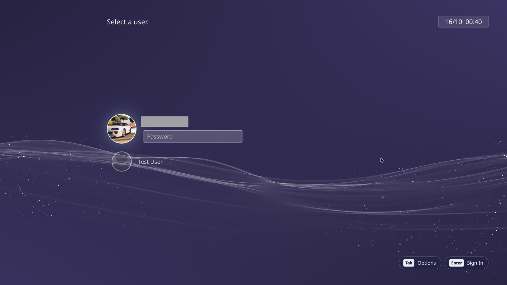
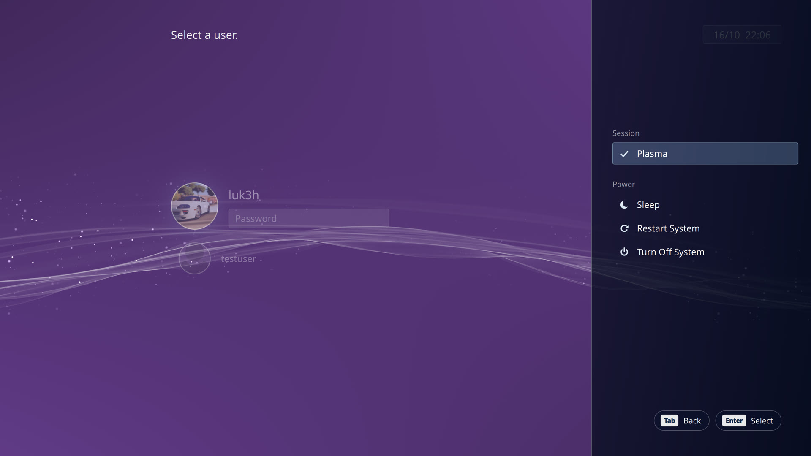
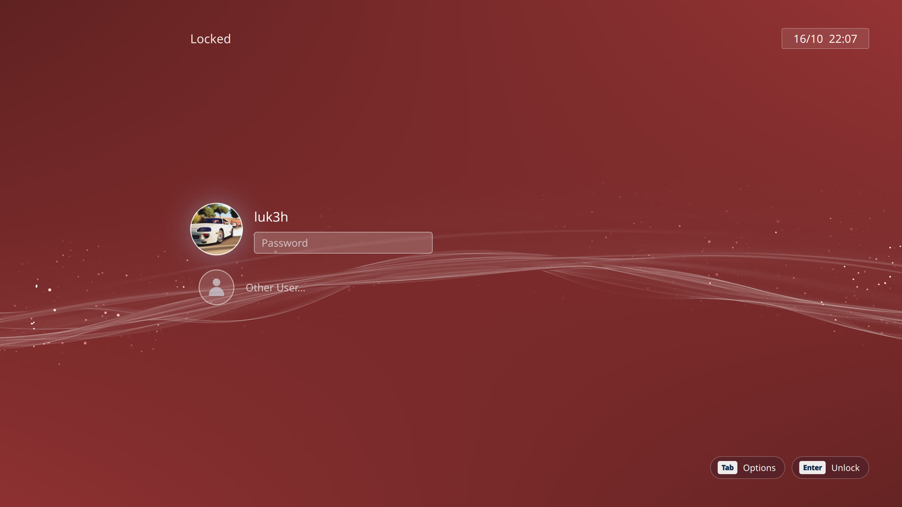
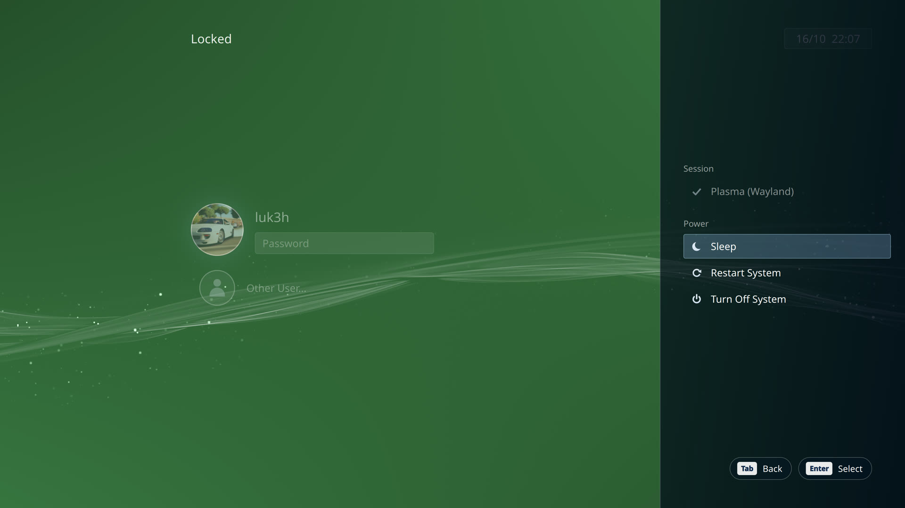
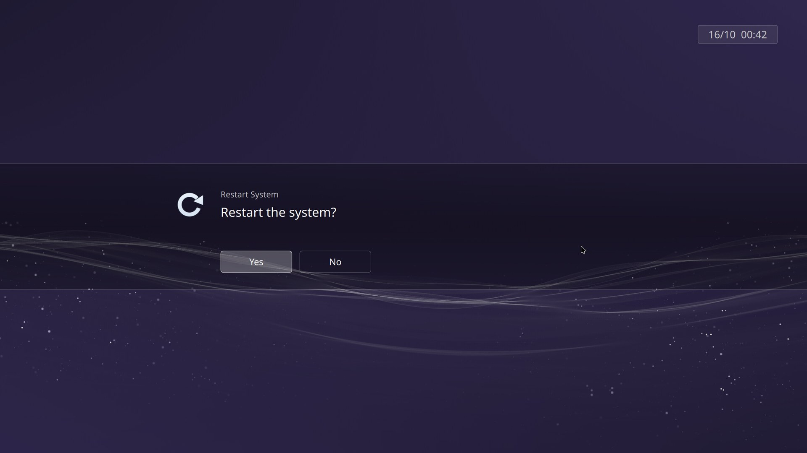
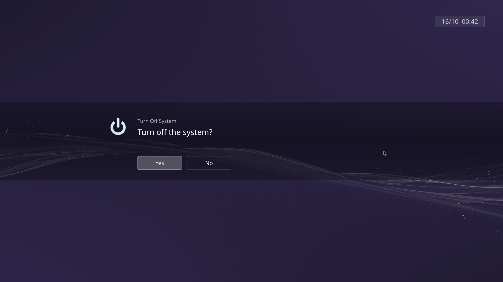
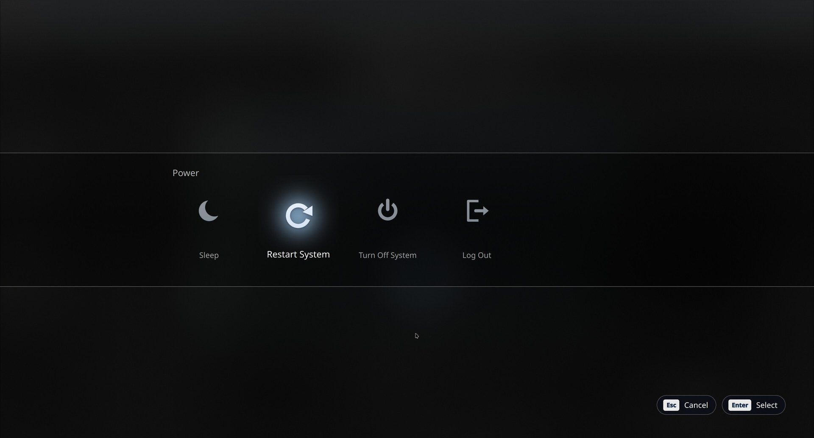
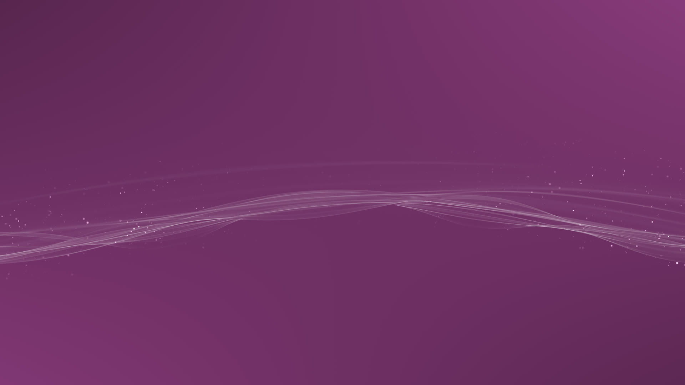

# XMB PS3 theme for KDE Plasma 6

A PlayStation 3 XMB-style **login screen**, **lock screen** and **Shut Down screen** for KDE Plasma 6, built to feel like one continuous console UI:

- The animated XMB wave, in the same day/night colours as your desktop wallpaper, and in sync with it
- A PS3-style user column with round profile pictures
- A clock box, `[Tab] Options` / `[Enter] Sign In` key hints and a slide-in Options panel
- "Restart the system?" Yes/No confirmations, then "Restarting..." and a fade to black
- Smooth fades between the lock screen, login screen and desktop, across multiple monitors
- Soft PS3-style menu sounds (original, made for this theme; `--no-sounds` turns them off)


## Screenshots

<table>
  <tr>
    <th width="50%">Login screen</th>
    <th width="50%">Login screen: Options</th>
  </tr>
  <tr>
    <td width="50%"></td>
    <td width="50%"></td>
  </tr>
  <tr>
    <th width="50%">Lock screen</th>
    <th width="50%">Lock screen: Options</th>
  </tr>
  <tr>
    <td width="50%"></td>
    <td width="50%"></td>
  </tr>
  <tr>
    <th width="50%">Restart confirmation</th>
    <th width="50%">Turn off confirmation</th>
  </tr>
  <tr>
    <td width="50%"></td>
    <td width="50%"></td>
  </tr>
  <tr>
    <th width="50%">Shut Down screen (Ctrl+Alt+Del)</th>
    <th width="50%">The XMB wave on the desktop</th>
  </tr>
  <tr>
    <td width="50%"></td>
    <td width="50%"></td>
  </tr>
</table>

The wave changes colour through the day, like the PS3: each shot shows a different hour (blue, purple, crimson, gold, green, teal, magenta).

---

## What's included

| Part | What it replaces | Installed to |
|---|---|---|
| **Login screen** | SDDM theme | `/usr/share/sddm/themes/xmb-ps3` |
| **Lock screen** | Plasma's lock screen (Meta+L) | `/usr/local/share/xmb-lockscreen`, swapped into Plasma's lock screen folder |
| **Shut Down screen** | The Restart / Shut Down / Log Out screen | `~/.local/share/plasma/look-and-feel/com.github.luk3h.xmbps3` |
| **Login splash** | The splash while your desktop loads (a plain black one, so the desktop fades in on every monitor at once) | same package as above |
| **Wave clock sync** *(optional)* | One line in the Shader Wallpaper plugin, so the desktop, lock and login waves line up | your Shader Wallpaper plugin folder |

### Controls

| Key | Login screen | Lock screen |
|---|---|---|
| Up / Down | Choose a user | Move between you and **Other User…** |
| Enter | Sign in | Unlock (or go to the login screen on **Other User…**) |
| Tab | Options (session, Sleep, Restart, Turn Off) | Options (Sleep, Hibernate, Restart, Turn Off) |
| Esc | Options | *Turns the monitors off (a built-in KDE shortcut)* |

---

## Requirements

- **KDE Plasma 6** (tested on Plasma 6.7, Fedora 44) on Wayland
- **SDDM** with the Qt 6 greeter (for the login screen). See [Fedora 44+ and Plasma Login Manager](#fedora-44-and-plasma-login-manager) if your distro uses something else.
- `QtQuick.Effects` (part of Qt 6 declarative; installed with Plasma on most distros)
- *For the menu sounds:* Qt Multimedia (`qt6-qtmultimedia` on Fedora; usually already installed with Plasma). Without it everything works, just silently
- *Optional, recommended:* the **Shader Wallpaper** plugin, so your **desktop** gets the same animated XMB wave. See [The wave on your desktop](#the-wave-on-your-desktop-shader-wallpaper) below. Install it **before** running `./install.sh`, or just run `./install.sh` again afterwards.

> The animated XMB wave shader is included in `shaders/` (see Credits). The login and lock screens use it automatically. Use `--shader FILE` to use a different one.

---

## Install

You need `git` to download it. Fedora: `sudo dnf install git` · Ubuntu/Debian: `sudo apt install git` · Arch: `sudo pacman -S git`.
(No git? Click **Code → Download ZIP** at the top of this page, extract it, and run `./install.sh` from the extracted folder.)

```bash
git clone https://github.com/luk3h/xmb-ps3-theme.git
cd xmb-ps3-theme
./install.sh
```

Run it as your normal user. It asks for your password when it needs `sudo`.

### Options

Add any of these after `./install.sh`, e.g. `./install.sh --no-splash --yes`:

| Option | What it does | Affects |
|---|---|---|
| `--choose` | Ask about each part one by one, instead of installing everything | n/a |
| `--no-login` | Skip installing the login screen. If it's already installed, everyone still sees it | Everyone |
| `--no-lock` | Skip installing the lock screen. If it's already installed, everyone still sees it | Everyone |
| `--lock-off-for-me` | Use KDE's normal lock screen for **your account**, while others keep the XMB one | Just you |
| `--lock-on-for-me` | Use the XMB lock screen for your account again | Just you |
| `--no-leave` | Don't install the Shut Down / Restart screen | Just you |
| `--no-splash` | Keep your current loading splash | Just you |
| `--no-sync` | Don't change Shader Wallpaper (the desktop wave won't line up with the login/lock wave) | Just you |
| `--no-displays` | Don't copy your monitor setup and audio output/volume to the login screen | Everyone |
| `--use-sddm` | Switch to SDDM if your PC uses another login manager ([see below](#fedora-44-and-plasma-login-manager)) | Everyone |
| `--no-sounds` | No menu sounds on the login, lock and Shut Down screens | Everyone (login/lock), just you (Shut Down) |
| `--sounds DIR` | Use sound files from another folder instead of `custom-sounds/` ([see below](#using-your-own-sounds)) | Everyone (login/lock), just you (Shut Down) |
| `--still-wave` | Keep the login/lock wave still (saves CPU on PCs without a proper graphics card) | Everyone |
| `--moving-wave` | Animate the wave even in a virtual machine | Everyone |
| `--shader FILE` | Use a different compiled wave shader (`.frag.qsb`) | Everyone |
| `-y`, `--yes` | Don't ask "Continue?" | n/a |
| `-h`, `--help` | List the options | n/a |

**Virtual machines:** the installer detects them and keeps the login and lock screen wave **still**, because redrawing the full-screen wave without a graphics card can freeze the VM window (GNOME Boxes even crashes). Use `--moving-wave` to animate it anyway.

### More than one user on the PC

| Part | Shared or per user? |
|---|---|
| Login screen | **Shared.** It appears before anyone logs in, so everyone gets the same one |
| Lock screen | **Shared**, but each user can switch it off for themselves (`--lock-off-for-me`) |
| Shut Down screen, loading splash, wave sync | **Per user.** Other users keep KDE's normal ones until they choose them |

After you've installed it, any other user can log in and pick exactly what they want. No admin password is needed for their own parts:

```bash
git clone https://github.com/luk3h/xmb-ps3-theme.git
cd xmb-ps3-theme
./install.sh --choose
```

It asks one question per part, for example *"Lock screen (shared, already installed) - use it for YOUR account?"*. Answering **n** to everything leaves their account vanilla, apart from the login screen, which can't be per user.

To remove only your own parts and leave the shared screens for everyone else:

```bash
./uninstall.sh --no-login --no-lock
```

A plain `./uninstall.sh` (needs an admin password) removes the shared login and lock screens for **everyone**, plus your own parts.

### The wave on your desktop (Shader Wallpaper)

The login and lock screens bring their own copy of the wave. For the **desktop**, you need the free **Shader Wallpaper** plugin by y4my4my4m:

1. Right-click the desktop → **Desktop and Wallpaper** → **Get New Plugins…**
2. Search **Shader Wallpaper** ("Shader Wallpaper for Plasma6 by y4my4my4m") and click **Install**.
3. It asks you to *Pick Your Installation Option*. Choose the newest, **`kde-shader-wallpaper-3.0.3-plasma6.zip`**. (The ⚠ icons are normal.)
4. Run `./install.sh` (again, if you already ran it). It should say **XMB wave added to Shader Wallpaper** and **Syncing the Shader Wallpaper clock... Patched**.
5. In Desktop and Wallpaper, set **Wallpaper type** to **Shader Wallpaper** and pick **xmb-wave** from its list.

What the installer changes in the plugin (`~/.local/share/plasma/wallpapers/online.knowmad.shaderwallpaper/`):

| File | Change | Undone by `./uninstall.sh`? |
|---|---|---|
| `contents/ui/Shaders6/xmb-wave.frag.qsb` | The XMB wave added to the plugin's shader list | No, on purpose: it may be your wallpaper. Delete it yourself if you like |
| `contents/ui/main.qml` | One line, so the desktop wave uses the same clock as the login/lock wave (no jump when you unlock). Original saved as `main.qml.xmb-orig` | Yes |

**Shader Wallpaper version 4** (built from source on [GitHub](https://github.com/y4my4my4m/kde-shader-wallpaper), not on the KDE Store) works differently, so the installer can't add the wave to it. Use its **Import** button instead and choose `shaders/xmb-wave.frag` from this folder. The clock sync isn't available there.

**In a virtual machine**, keep a normal image wallpaper. The installer makes the login and lock wave still in VMs, but the desktop wallpaper always animates, and without a graphics card that makes the whole VM sluggish.

### Using your own sounds

The built-in sounds are original ones made for this theme. To use your own, put the files in this repo's **`custom-sounds/`** folder, named `move`, `select`, `back`, `error` and `open` (any you leave out keep the built-in sound), then run `./install.sh`. It picks them up automatically, converting MP3/FLAC/OGG to WAV if `ffmpeg` is installed. See [`custom-sounds/README.md`](custom-sounds/README.md) for the details.

Files you put there are ignored by git, so they stay on your PC. You can also point at any other folder with `./install.sh --sounds ~/some-folder`. Only use sounds you have the right to use: this project doesn't include or link to anyone else's.

### Previews and screenshots

Try the screens safely, without locking or logging out:

```bash
scripts/preview.sh login    # login screen preview; can't sign in or turn anything off. Close with Ctrl+Q
scripts/preview.sh lock     # lock screen preview; unlock with your password, or it closes after 60 s
```

In the previews, Other User and the power buttons only show a note instead of really switching user or restarting. The banner at the top fades after 5 seconds (move the mouse to the top to bring it back), so you can take clean screenshots with Spectacle.

## Uninstall

```bash
./uninstall.sh
```

This puts back your previous login theme (and your previous login manager, if you used `--use-sddm`), the original lock screen, your Global Theme and splash settings, and the original Shader Wallpaper file. The installer saved them in `~/.config/xmb-ps3/`.

---

## How the lock screen works (and staying safe)

Since Plasma 6.1, the lock screen isn't part of any theme. Plasma always loads one fixed file, `/usr/share/plasma/shells/org.kde.plasma.desktop/contents/lockscreen/LockScreen.qml`. The installer saves the original as `LockScreen.breeze.qml` and puts a small loader in its place. A systemd path unit (`xmb-lockscreen.path`) re-applies it automatically if a Plasma update replaces the file.

- If the XMB lock screen ever fails to load, Plasma shows its own basic fallback lock, and your password still works.
- If you're ever stuck on a lock screen: press **Ctrl+Alt+F3**, log in, run `loginctl unlock-sessions`, then `sudo /usr/local/bin/xmb-lockscreen-restore`.

---

## Tips for multiple monitors

If one monitor blinks or arrives late when switching between the lock screen, login screen and desktop, it's usually re-syncing because of a different refresh rate in each place:

1. **Give the login screen your display setup.** The installer copies it for you (`--no-displays` to skip). You can also use System Settings → Colours & Themes → Login Screen (SDDM) → **Apply Plasma Settings…**. Do this again after changing resolution or refresh rate.
2. **Use the same mode from the moment you boot** (optional). Find your connectors with
   `for p in /sys/class/drm/card*-*; do echo "$(basename $p): $(cat $p/status)"; done`
   and add for example `video=DP-1:3840x2160@240 video=DP-2:2560x1440@144` to your kernel options (`sudo grubby --update-kernel=ALL --args="…"`). If your GRUB has `GRUB_ENABLE_BLSCFG=false`, also run `sudo grub2-mkconfig -o /boot/grub2/grub.cfg`.
3. **Monitor menu:** turning off *input auto-switch / auto source* and *resolution notice* makes monitors come back from a signal change faster.
4. **Desktop icons jumping between monitors at login:** use the **Desktop** layout (not Folder View) on every monitor except your main one.

---

## Credits & licence

- **How it was made:** designed, tested and maintained by **luk3h**, with the code written mostly by **Claude** (Anthropic's AI). I decided how every screen should look, behave and sound, tested each change on real hardware and in a VM, and tracked down the bugs; Claude wrote most of the QML and scripts. Bug reports and pull requests are welcome.
- **XMB wave shader** (`shaders/`): originally ["PS3 Menu effect"](https://www.shadertoy.com/view/tXy3DK) by **[int_45h](https://www.shadertoy.com/user/int_45h)**, who released it freely ("do whatever you want with this shader... if you can leave a comment or something or hit me up, that'd be dope"). Updated as ["Ps3 XMB 3.0 Background"](https://www.shadertoy.com/view/fcf3Dn) by **[llmciv](https://www.shadertoy.com/user/llmciv)** (dithering, smoother raymarching, anti-aliasing, time-of-day colours). Starfield based on xaot88's, hash function after Dave Hoskins. Converted for Qt 6 with an hourly colour palette for this theme. The source is included; see [`shaders/README.md`](shaders/README.md) for the full credits and how to change the wave. Thank you, int_45h and llmciv! If you use this theme, go leave them a comment on Shadertoy.
- **Menu sounds** (`sounds/`): original, generated from sine tones for this theme (see [`sounds/README.md`](sounds/README.md)). No Sony audio is used.
- Everything else is licensed under the **GNU GPL v3 or later** (see `LICENSE`).
- The optional wave clock sync changes one line of **Shader Wallpaper** by @y4my4my4m (GPL-3.0); the original file is kept and restored by `uninstall.sh`.
- Inspired by the PlayStation 3 XMB. This is a fan project, **not affiliated with or endorsed by Sony Interactive Entertainment**. It contains no Sony logos or assets; "PlayStation" and "PS3" are trademarks of their owners.
